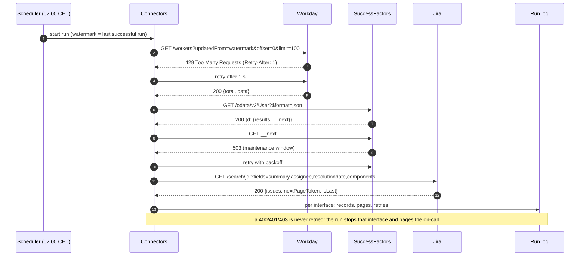
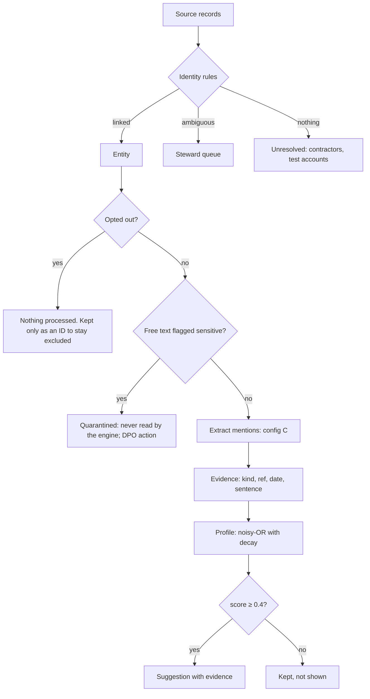
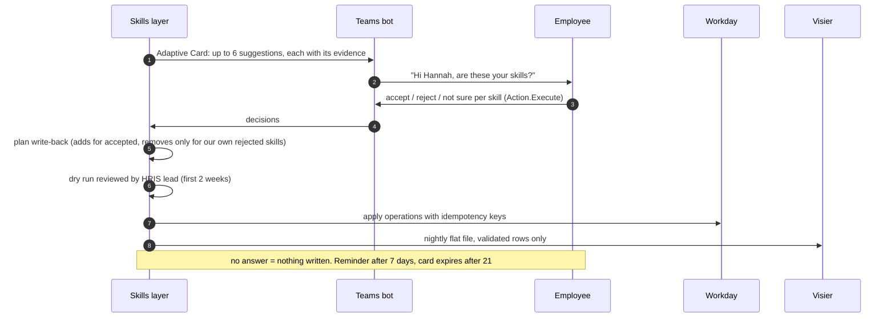

# Data flows

## 1. Nightly sync



Retry policy (`skillslayer/sources/http.py`):

- 429, 500, 502, 503 and 504 are retried up to 5 times. Retry-After is honoured when present; otherwise the client backs off exponentially from 0.5 s with jitter.
- 400, 401, 403 and 404 are not retried, because the request itself is wrong. The eval checks that a 401 produces exactly one attempt.
- The watermark only moves forward when the whole run succeeded. A failed night re-reads from the last good watermark, so nothing is skipped.

## 2. From records to suggestions



## 3. Validation and write-back



## 4. Reconciliation (weekly)

A full read (no watermark) is compared with the state the delta runs built up. Every difference is listed with a reason: a terminated worker, a changed job profile, or a record a delta missed. A difference without a reason is an incident. This catches the classic delta bug where a source changes a record without touching its "last updated" field ([ADR-0006](../02-decisions/ADR-0006-delta-sync-with-weekly-reconciliation.md)).

## The run log

`python -m skillslayer sync --simulate` prints the run log this design produces:

```
fetch workday                          197 records    2 pages  1 retries
fetch successfactors:User               95 records    3 pages  1 retries
fetch successfactors:EmpJob            190 records    5 pages  1 retries
fetch successfactors:FOJobCode          18 records    1 pages  0 retries
fetch successfactors:cust_AboutMe       48 records    2 pages  1 retries
fetch jira                            1211 records   13 pages  1 retries
identities: 266 people, 22 for the steward, 24 unresolved
excluded (opt-out): 7 people; quarantined texts: 4
suggestions: 479 for 180 people
validation (simulated): 322 accepted, 50 rejected, 14 unsure
write-back plan: 207 adds, 1 removes (dry run)
analytics export: 322 validated rows
```
