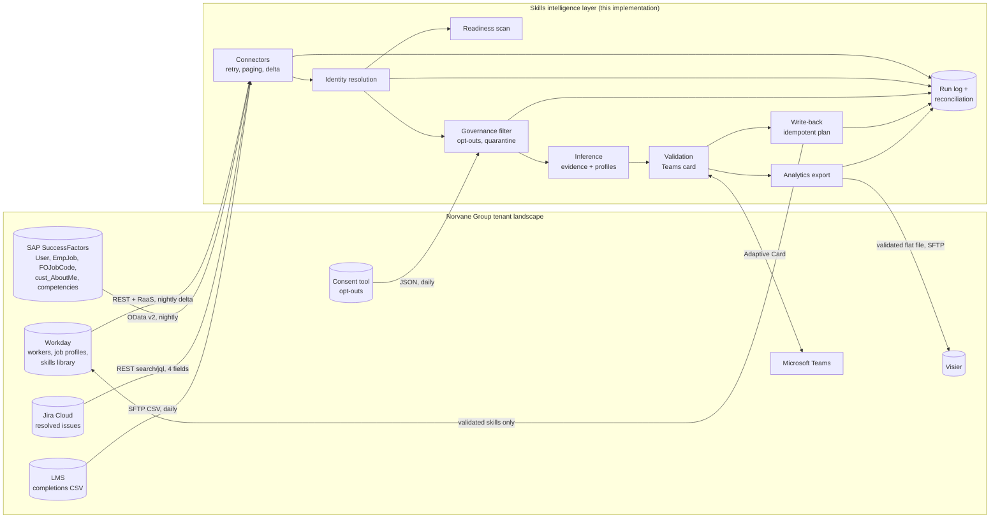

# Integration architecture

## The picture

Read the arrows as **who calls whom**. The layer pulls from every source. It pushes to exactly two places: Workday (validated skills) and Visier (a validated flat file). The only interactive channel is the Teams card.

## Interface inventory

| # | System | Direction | Mechanism | Frequency | Volume (wave 1 / all) | Auth | Owner on customer side |
|---|---|---|---|---|---|---|---|
| I1 | Workday workers | in | REST `GET /workers`, offset/limit ≤ 100, `updatedFrom` watermark | nightly delta, weekly full | 197 / ~9,000 | OAuth 2.0 client for an integration system user (ISU) | HRIS lead |
| I2 | Workday job profiles | in | RaaS custom report `Job_Profiles_for_Skills_Layer`, JSON | nightly | 48 / ~400 | same ISU | HR job architecture |
| I3 | Workday skills library | in | RaaS custom report `Skills_Library` | weekly | 99 / ~300 | same ISU | HRIS lead |
| I4 | SuccessFactors people and jobs | in | OData v2: `User`, `EmpJob` (effective-dated), `FOJobCode`; server-side paging via `__next` | nightly | 95 users / ~1,600 | OAuth 2.0 SAML bearer assertion, API user with a read-only role | SF admin |
| I5 | SuccessFactors about-me | in | OData v2 custom MDF object `cust_AboutMe` | nightly | 48 / ~800 | same | SF admin + DPO |
| I6 | SuccessFactors competency library | in | Integration Center export to SFTP (JSON) | one-off + monthly | 41 | SFTP key | SF admin |
| I7 | Jira Cloud issues | in | `GET /rest/api/3/search/jql` with `fields=summary,assignee,resolutiondate,components`, `nextPageToken` paging | nightly | 1,211 / ~40,000 | API token of a service account, read-only project role | Atlassian admin |
| I8 | Jira users | in | `GET /rest/api/3/users/search` | weekly | 151 | same | Atlassian admin |
| I9 | LMS completions | in | CSV over SFTP | daily | 546 rows | SFTP key | L&D |
| I10 | Consent / opt-outs | in | JSON export | daily, plus on-demand | 7 | SFTP key | employee relations |
| O1 | Workday worker skills | out | skills on the worker profile, written by the ISU; idempotent plan, dry run first | after validation, nightly | 207 adds in the pilot | same ISU, write permission on the skills domain only | HRIS lead |
| O2 | Teams validation card | out/in | bot app, Adaptive Card 1.5 with `Action.Execute` | on suggestion, reminder after 7 days | 1 card per person | Entra ID app registration, admin consent | IT + internal comms |
| O3 | Visier | out | flat file (CSV) over SFTP, effective-dated | nightly | <!--n:governance.with_controls.export_rows-->322<!--/n--> validated rows in the pilot | SFTP key | people analytics |

Volumes in the "wave 1" column come from this repository's run (see the run log in `python -m skillslayer sync`). Each interface is specified field by field in [interface specs](interface-specs.md).

## Principles

1. **Pull, don't be pushed to.** Every source is read on our schedule through a documented API or export. No customer system has to call us, so there are fewer firewall rules and fewer people who have to say yes.
2. **API first, file as fallback** ([ADR-0004](../02-decisions/ADR-0004-api-first-file-fallback.md)). We use files where the customer's standard is a file (LMS, Visier custom data, the SuccessFactors library export).
3. **Ask for fields, not records.** Jira gets an explicit `fields=` list ([ADR-0002](../02-decisions/ADR-0002-work-metadata-not-message-content.md)), and the Workday RaaS report has only the columns we map.
4. **Governance before inference.** Opt-outs and quarantine are applied before any text reaches the engine, not filtered at the end.
5. **Write only what was validated, and only what we own** ([ADR-0001](../02-decisions/ADR-0001-employees-validate-before-anything-leaves.md), [ADR-0007](../02-decisions/ADR-0007-write-back-owns-only-its-own-skills.md)).
6. **Every run is reconcilable.** The run log has records in, records out, retries, exclusions and operations per interface ([data flows](data-flows.md)).

## What is not here, on purpose

- **No Teams or Slack message content.** Teams is a delivery channel only ([ADR-0002](../02-decisions/ADR-0002-work-metadata-not-message-content.md)).
- **No write-back to SuccessFactors** in wave 1. Keldorf people who already moved are written to Workday. The others get their validated skills in the analytics export and in the platform UI until the 2027 migration decision ([ADR-0003](../02-decisions/ADR-0003-workday-is-the-identity-anchor.md)).
- **No middleware product.** The customer has no iPaaS standard yet. If Norvane picks one (Workato, Boomi, MuleSoft, SAP Integration Suite), the connectors become flows in it and the rules stay the same.
