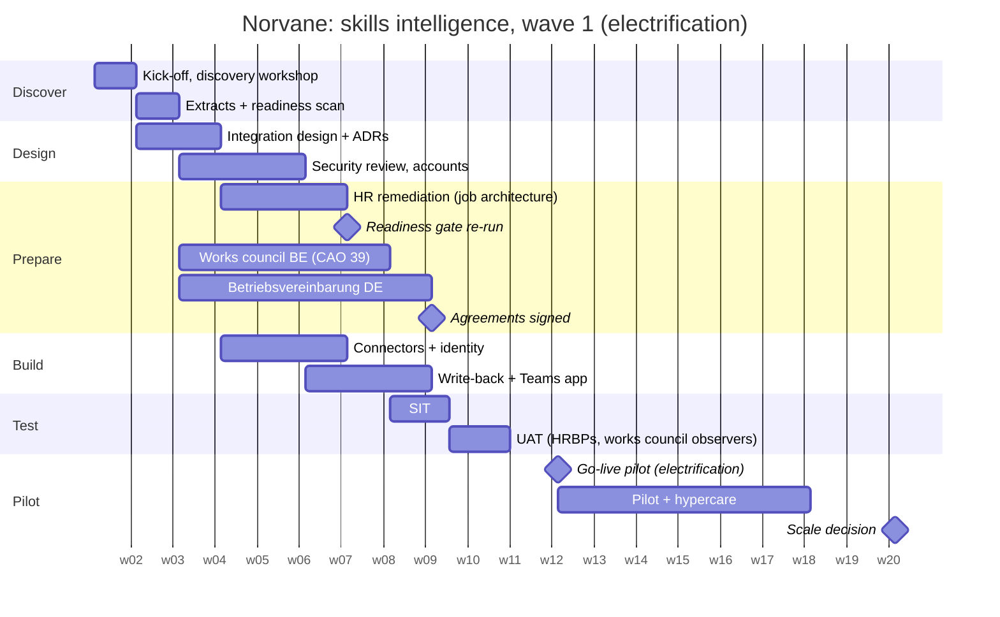

# Implementation plan

20 weeks from kick-off to the scale decision. The plan is built around two hard checkpoints: the **readiness gate** (week 7) and the **works council agreements** (week 9). Nothing in production depends on a date that does not depend on those two first.

## Phases, outputs and exit criteria

| Phase | Weeks | Outputs | Exit criterion |
|---|---|---|---|
| **Discover** | 1–2 | discovery notes, system map, stakeholder map, success criteria, readiness report | sponsor accepts the readiness verdict and the remediation owners |
| **Design** | 2–4 | integration architecture, interface specs, ADRs, security pack, DPIA draft | HRIS lead and IT architect sign the design; DPO accepts the DPIA draft |
| **Prepare** | 3–7 | remediation done by HR; works council information and consultation | readiness gate passes (week 7); agreements on track |
| **Build** | 4–9 | connectors configured against the implementation tenant, identity rules, Teams app, write-back, analytics export, run log | SIT entry: all interfaces green in the build environment |
| **Test** | 8–11 | SIT, UAT, per-language recall on a labelled Norvane sample | UAT sign-off by HR director; agreements signed |
| **Pilot** | 12–17 | go-live for electrification, validation wave 1, hypercare | success criteria S1–S8 ([success criteria](../00-engagement/success-criteria.md)) |
| **Scale decision** | 18–20 | pilot report, wave 2 plan, product feedback summary | steering decides on the next divisions |

## Critical path and buffers

1. **Works council in Germany** (6 weeks planned). Every day of delay moves the pilot for Keldorf. Mitigation: the Belgian part of the pilot can start alone. The design already supports going live per legal entity.
2. **Security review** (3 weeks). It runs in parallel with design, and the security pack is sent in week 2.
3. **Job architecture fixes** (3 weeks, by HR). If the week-7 gate fails, the pilot starts with the subset that passes ([ADR-0008](../02-decisions/ADR-0008-phased-rollout-behind-a-readiness-gate.md)).

## Working rhythm

- Weekly working session with the HRIS lead and the SF admin (60 min), with a written status every Friday ([example](status-report-example.md)).
- Steering every 4 weeks: CHRO, HR director, IT architect, DPO and the vendor's engagement lead.
- Decisions go into an ADR or the decision log, never only into a meeting.
- Field insights are logged the same day they appear and reviewed with the vendor's product team every two weeks ([field insights](../07-product-feedback/field-insights.md)).
